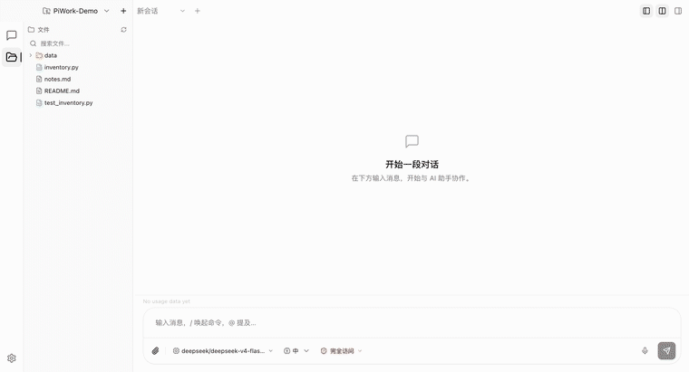
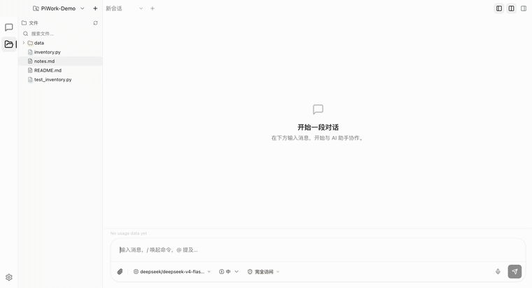
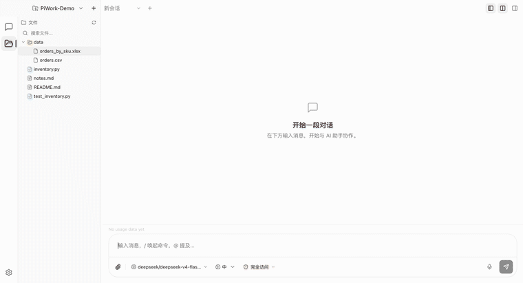
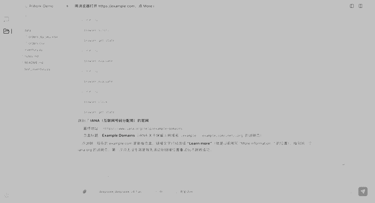
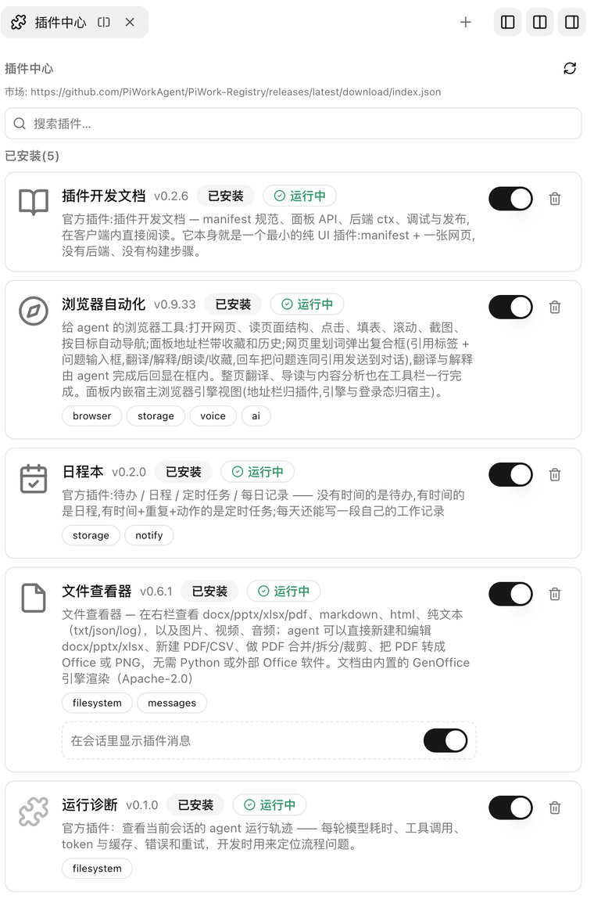

# PiWork

[简体中文](README.md) | English

An AI coding assistant desktop app built with Electron + React, available as both a web app and a desktop app.

## Download

[](https://github.com/PiWorkAgent/PiWork/releases/latest)

Click the button above (or open [Releases](https://github.com/PiWorkAgent/PiWork/releases/latest)) and pick the installer for your platform:

| Platform | Installer |
|----------|-----------|
| macOS (Apple silicon) | `.dmg` with `-arm64` in the filename |
| macOS (Intel) | `.dmg` without an architecture suffix |
| Windows (x64) | `.exe` |
| Linux (x64) | `.AppImage` or `.deb` |

> Artifacts are not Developer ID signed or notarized yet (macOS builds are ad-hoc signed). If macOS says “cannot verify the developer” on first launch, open **System Settings → Privacy & Security** and click **Open Anyway**. If it says the app “is damaged and can't be opened” (older browser-downloaded builds may report this), run `xattr -dr com.apple.quarantine /Applications/PiWork.app` in a terminal first. On Windows, SmartScreen may appear — choose **More info → Run anyway**.

> macOS 13 (Ventura) or later is required.

## Features

- **Conversational agent** — streaming output, visible thinking, tool-call cards; interactive cards for questions and task lists; permission approval (default / full access); edit and resend, regenerate, switch conversation branches.
- **Workspaces and sessions** — one workspace maps to one folder; sessions are managed per workspace; multiple windows work independently, and the same session opens in only one window to avoid contention.
- **Context** — persistent AGENTS.md / CLAUDE.md instructions, SYSTEM.md replacement or append, skill toggles, and a visualization of context usage and per-segment overhead.
- **Panels and previews** — file tree; left and right panels with tabs and splits; plugin panels embedded into the workspace as native views.
- **Models** — multiple providers and models; built-in providers support OAuth / API key login; thinking-level switching; fetch the available model list from a provider.
- **MCP** — configure MCP servers globally or per project; their tools automatically become available in conversations.
- **Plugins** — plugin center and marketplace, install / update / rollback, permission confirmation; dev mode can load plugin source directly.
- **Voice** — record and transcribe input; read replies aloud; built-in sherpa-onnx models, or connect a custom provider.
- **Appearance and language** — light / dark / follow system; UI font scaling; Chinese / English.
- **Other** — slash commands, usage and latency statistics, in-app update check with installer download.

## Demo

> Recorded with the 0.4.x UI. Browser automation and document previews come from official plugins — plugins embed capability directly into the workspace instead of opening an external window.

### Chat and files

Ask a question in a sample project; the agent reads the code, fixes a bug, adds tests, runs them, and opens the documentation in the right panel.



### Document processing

Preview Markdown and CSV, then have the agent summarize by SKU and generate an xlsx report; the spreadsheet opens directly in the right column.



### Browser automation

One sentence tells the agent to open a web page, click a link, and report the result.



### Settings and themes

Switch light / dark mode, font size, and Chinese / English UI instantly.



## Tech stack

| Area | Technology |
|------|------------|
| **Desktop shell** | Electron 45 + electron-vite |
| **Frontend** | React 19 + TypeScript |
| **Build** | Vite 8 + Turborepo + pnpm workspace |
| **UI** | Tailwind CSS 4 + Radix UI (shadcn-style components) |
| **State** | Zustand + TanStack Query |
| **Document parsing** | `adm-zip` + a custom OOXML parser (docx / xlsx / pptx); PDF and rich previews are rendered by the File Viewer plugin |
| **Voice** | sherpa-onnx (built-in STT / TTS) + custom providers |
| **AI SDK** | @earendil-works/pi-coding-agent |
| **Plugin SDK** | @weiqun789/plugin-sdk |
| **Packaging** | electron-builder + GitHub Actions (four platforms) |

## Architecture

The project is a monorepo: the desktop and web apps share the same UI components and differ only in the transport layer.

```
Desktop:  Renderer (React) ──IPC──▶ Main Process ──▶ SDK ──▶ AI Backend
Web:      Browser (React)  ──HTTP─▶ Vite API Proxy ──▶ SDK ──▶ AI Backend
```

```
PiWork/
├── apps/
│   ├── desktop/          # Electron desktop app
│   │   ├── src/main/     # Main process (window management, IPC)
│   │   ├── src/preload/  # Preload scripts (contextBridge)
│   │   └── src/renderer/ # Renderer (React)
│   └── web/              # Web app
├── packages/
│   ├── sdk-wrapper/      # SDK wrapper (IPC/HTTP dual transport)
│   ├── types/            # Shared type definitions
│   ├── ui/               # Shared UI component library (layout, chat, previews, …)
│   └── plugin-sdk/       # Plugin backend SDK (npm: @weiqun789/plugin-sdk)
├── scripts/              # setup / dev-plugin / fetch-market helpers
├── templates/            # Plugin scaffold (connector plugins)
├── pnpm-workspace.yaml
└── turbo.json
```

Plugins are not in this repository. Each first-party plugin is its own repository (see [Plugins](#plugins)) and is installed and updated through the plugin marketplace.

## Requirements

- Node.js >= 22.18.0 (matching `engines` in the root `package.json`)
- pnpm >= 9.0.0

## Quick start

```bash
# Install dependencies and build packages/*/dist (the app references these artifacts)
pnpm setup

# Start the web dev server (localhost:5173)
# The web app has a built-in API proxy; no separate backend process is needed
pnpm dev:web

# Start the Electron desktop app: plugins are installed from the marketplace into ~/.pi/agent/plugins
pnpm dev:desktop

# Edit plugin source (plugins live in separate repositories, see “Plugins”)
PI_DEV_PLUGINS=/path/to/PiWork-Plugin-Browser pnpm dev:desktop:plugins
```

`pnpm setup` does exactly two things: install root dependencies and build the root packages. Plugin dependencies are no longer installed with this repository.

## Plugins

Plugins are **independent release units** and are not part of this repository. Each plugin has its own GitHub repository; the release artifacts are a `zip + index.json` attached to a GitHub Release. A registry repository aggregates every plugin's release into the marketplace index the client reads.

The web app does not load plugins: browser automation, document previews, and similar capabilities require the desktop app.

| Repository | Purpose |
| --- | --- |
| [PiWork-Plugin-Browser](https://github.com/PiWorkAgent/PiWork-Plugin-Browser) | Browser automation `com.pi.browser` |
| [PiWork-Plugin-Files](https://github.com/PiWorkAgent/PiWork-Plugin-Files) | File Viewer `com.pi.files` |
| [PiWork-Plugin-Tasks](https://github.com/PiWorkAgent/PiWork-Plugin-Tasks) | Planner `com.pi.tasks` |
| [PiWork-Plugin-Docs](https://github.com/PiWorkAgent/PiWork-Plugin-Docs) | Plugin development docs `com.pi.devdocs` (the development guide lives here too) |
| [PiWork-Plugin-Diagnostics](https://github.com/PiWorkAgent/PiWork-Plugin-Diagnostics) | Runtime diagnostics `com.pi.diagnostics` |
| [PiWork-Registry](https://github.com/PiWorkAgent/PiWork-Registry) | Marketplace index (official + community plugins) |

### Plugin center

Open **Plugin Center** in the right panel to browse the marketplace, install / update / roll back, confirm permissions, and enable or disable installed plugins. Installed plugins appear in the **Open plugin** menu: a panel is a web page inside the plugin package, hosted in the right panel by the app; the backend process is started, supervised, and restarted by the host.



### Plugin demos

Plugin capabilities are not sidecar scripts — they live directly inside the workspace. These demos are powered by different plugins:

| Plugin | See it in PiWork |
| --- | --- |
| Browser automation `com.pi.browser` | [Browser automation demo](https://github.com/PiWorkAgent/PiWork-Plugin-Browser#browser-automation-in-piwork) |
| File Viewer `com.pi.files` | [Document processing demo](https://github.com/PiWorkAgent/PiWork-Plugin-Files#document-processing-in-piwork) |
| Planner `com.pi.tasks` | [Planner panel demo](https://github.com/PiWorkAgent/PiWork-Plugin-Tasks#the-planner-in-piwork) |
| Runtime diagnostics `com.pi.diagnostics` | [Diagnostics panel demo](https://github.com/PiWorkAgent/PiWork-Plugin-Diagnostics#diagnostics-in-piwork) |
| Plugin development docs `com.pi.devdocs` | [Docs panel demo](https://github.com/PiWorkAgent/PiWork-Plugin-Docs#the-docs-panel-in-piwork) |

The marketplace index the client reads:

```
https://github.com/PiWorkAgent/PiWork-Registry/releases/latest/download/index.json
```

You can point the client at a local directory, mirror, or private marketplace with the `PI_PLUGIN_REGISTRY` environment variable (or `registry` in `~/.pi/agent/plugins/_state.json`). Installed packages **no longer bundle a plugin snapshot**: after installing the app, the first plugin install needs access to the marketplace source (the GitHub URL above by default). For offline environments, configure a mirror or a local marketplace.

**Two launch modes, two plugin sources.** The plugin lookup root is resolved in priority order `dev > user`:

- **`pnpm dev:desktop` (customer path)**: no dev root; the app only reads `~/.pi/agent/plugins/`. Install, update, and rollback all go through the real marketplace flow in the plugin center (sha256 verification, permission confirmation, atomic replacement). This is how to verify “what a user will actually see”.
- **`pnpm dev:desktop:plugins` (plugin development)**: point `PI_DEV_PLUGINS` at a plugin repository checkout to load the source directly; edits take effect immediately. It shadows a same-named copy in the user directory, so it cannot be used to test the install / update flow.
- `pnpm dev:desktop:raw` is a historical alias of the customer path and is equivalent to `pnpm dev:desktop`.

**Developing a plugin** (Browser as an example):

```bash
git clone https://github.com/PiWorkAgent/PiWork-Plugin-Browser
cd PiWork-Plugin-Browser && npm install && npm run build
PI_DEV_PLUGINS=/path/to/PiWork-Plugin-Browser pnpm dev:desktop:plugins   # run inside the PiWork repository
```

The plugin development spec (manifest fields, panel API, backend `ctx`, release flow) is in [PiWork-Plugin-Docs](https://github.com/PiWorkAgent/PiWork-Plugin-Docs/blob/main/docs/plugin-dev-guide.md); you can also read it in the **Plugin development docs** panel inside the client. Plugin backends depend on the SDK (npm package `@weiqun789/plugin-sdk`, installed in plugins under the alias `@pi/plugin-sdk`, bundled into `dist/main.mjs` at build time).

## Command reference

### Development

| Command | Description |
|---------|-------------|
| `pnpm setup` | One-command setup: root install + root build |
| `pnpm dev:web` | Start the web app (localhost:5173) |
| `pnpm dev:desktop` | Start the Electron desktop app (customer path, reads `~/.pi/agent/plugins/`) |
| `pnpm dev:desktop:plugins` | Load a plugin checkout (requires `PI_DEV_PLUGINS=/path/to/PiWork-Plugin-*`) |
| `pnpm dev:desktop:raw` | Historical alias of the customer path, equivalent to `pnpm dev:desktop` |
| `pnpm diag:sessions` | Generate a session diagnostics report |

### Build and packaging

| Command | Description |
|---------|-------------|
| `pnpm build` | Build all sub-packages |
| `pnpm pack:mac` | Package the macOS app (.dmg) |
| `pnpm pack:win` | Package the Windows app (.exe) |
| `pnpm pack:linux` | Package the Linux app (AppImage) |
| `pnpm pack:all` | Package all platforms |

Artifacts are written to `apps/desktop/release/`.

### Code quality

| Command | Description |
|---------|-------------|
| `pnpm typecheck` | TypeScript type check |
| `pnpm test` | Run tests (desktop `node:test` + plugin-sdk smoke tests) |
| `pnpm format` | Format code (Prettier) |
| `pnpm clean` | Clean build artifacts |

## Releasing

The single source of truth for the version is `version` in `apps/desktop/package.json`. The tag must match it exactly, otherwise the release workflow fails before packaging.

```bash
# 1. Bump the version (only edits the file; no automatic git tag)
cd apps/desktop && npm version 0.4.6 --no-git-tag-version && cd ../..

# 2. Commit, tag with the matching version, and push (the tag triggers the release)
git commit -am "Release 0.4.6"
git tag v0.4.6
git push origin HEAD --tags
```

After the tag is pushed, `.github/workflows/release.yml` runs:

1. **verify** — the same build / typecheck / test as CI; stop here if anything fails;
2. **build** — one installer each for macOS (arm64 + x64), Windows x64, and Linux x64;
3. **publish** — create a GitHub Release, attach the four platform artifacts to Assets, and generate the body automatically.

A tag containing `-` (such as `v0.2.0-beta.1`) is automatically marked as a prerelease. Artifacts are not Developer ID signed or notarized yet; macOS packages are only ad-hoc signed after packaging (`apps/desktop/scripts/adhoc-sign-mac.cjs`), so after downloading you still need to allow the app once in **Privacy & Security**. Once you have an Apple Developer certificate, remove `mac.identity: null` from `electron-builder.yml` and enable notarization to drop that step.
