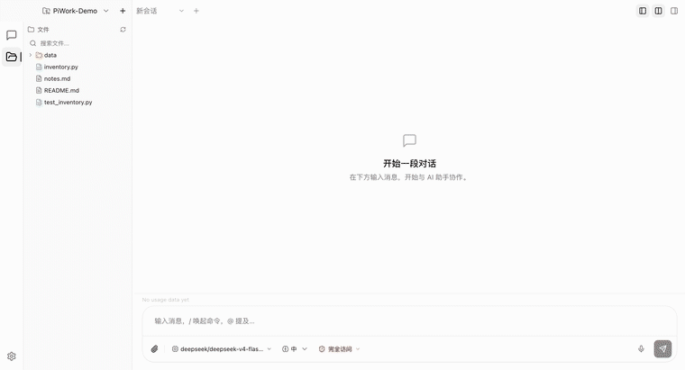
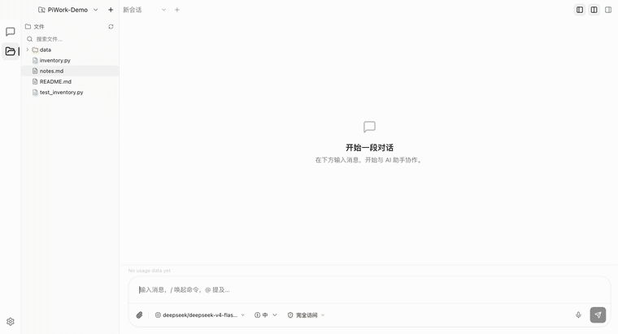
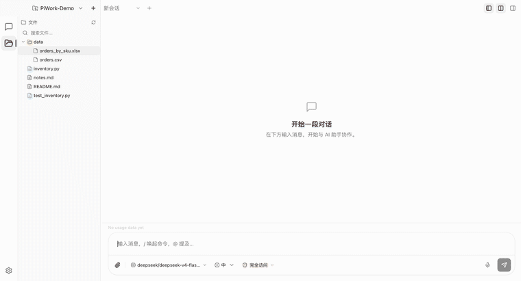
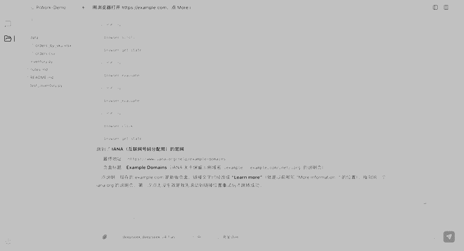

# PiWork

基于 Electron + React 的 AI 编程助手桌面应用，提供 Web 和桌面双端体验。

## 下载

[](https://github.com/PiWorkAgent/PiWork/releases/latest)

点上面按钮（或直接打开 [Releases](https://github.com/PiWorkAgent/PiWork/releases/latest)），按平台取安装包：

| 平台 | 安装包 |
|------|--------|
| macOS（Apple 芯片） | `.dmg`，文件名带 `-arm64` |
| macOS（Intel） | `.dmg`，文件名不带架构后缀 |
| Windows（x64） | `.exe` |
| Linux（x64） | `.AppImage` 或 `.deb` |

> 产物暂未做 Developer ID 签名与公证（macOS 安装包内已做 ad-hoc 签名）。macOS 首次打开若提示「无法验证开发者」，打开「系统设置 → 隐私与安全性」，点「仍要打开」；若提示「已损坏，无法打开」（浏览器下载的旧版本可能这样报），先在终端执行 `xattr -dr com.apple.quarantine /Applications/PiWork.app` 再打开。Windows 会出现 SmartScreen 提示，选「更多信息」→「仍要运行」。

> macOS 端要求 macOS 13（Ventura）及以上。

## 主要功能

- **对话代理** — 流式输出、思考过程展示、工具调用卡片；提问 / 任务清单等交互卡片；
  权限审批（默认 / 全权限两种模式）；编辑重发、重新生成、会话分支切换
- **工作区与会话** — 一个工作区对应一个文件夹；会话按工作区管理；
  多窗口独立工作，同一会话只在一个窗口打开，避免互相抢占
- **上下文** — AGENTS.md / CLAUDE.md 常驻指令、SYSTEM.md 替换或追加、技能开关、
  上下文占用与分段开销可视化
- **面板与预览** — 文件树；左右面板 + 标签 + 分栏；插件面板以原生视图嵌入工作区
- **模型** — 多服务商、多模型；内置服务商支持 OAuth / API Key 登录；思考等级切换；
  可从服务商拉取可用模型列表
- **MCP** — 配置 MCP 服务器（全局 / 项目级），工具自动进入会话
- **插件** — 插件中心与市场，安装 / 更新 / 回滚，权限确认；
  开发模式可直接加载插件源码
- **语音** — 录音转写输入；回复朗读；内置 sherpa-onnx 模型，也可接自定义服务商
- **外观与语言** — 浅色 / 深色 / 跟随系统；界面字号缩放；中文 / English
- **其他** — 斜杠命令、用量与耗时统计、应用内检查更新并下载安装包

## 功能演示

> 以下素材基于 0.4.x 版本界面录制。

### 对话与文件

在示例项目里提问，agent 读取代码、修复 bug、补测试并运行，随后在右侧打开说明文档。



### 文档处理

预览 Markdown 与 CSV，再让 agent 按 SKU 汇总生成 xlsx 报表，右栏直接查看表格。



### 浏览器自动化

一句话让 agent 打开网页、点击链接并汇报结果。



### 设置与主题

深浅色、字号和中英文界面即时切换。



## 技术栈

| 类别 | 技术 |
|------|------|
| **桌面框架** | Electron 45 + electron-vite |
| **前端框架** | React 19 + TypeScript |
| **构建工具** | Vite 8 + Turborepo + pnpm workspace |
| **UI** | Tailwind CSS 4 + Radix UI（shadcn 风格组件） |
| **状态管理** | Zustand + TanStack Query |
| **文档解析** | `adm-zip` + 自研 OOXML 解析（docx / xlsx / pptx）；PDF 与富文本预览由「文件查看器」插件渲染 |
| **语音** | sherpa-onnx（内置识别 / 合成）+ 自定义服务商 |
| **AI SDK** | @earendil-works/pi-coding-agent |
| **插件 SDK** | @weiqun789/plugin-sdk |
| **打包发布** | electron-builder + GitHub Actions（四平台） |

## 架构概览

项目采用 monorepo 架构，桌面端和 Web 端共享同一套 UI 组件，仅传输层不同：

```
桌面端:  Renderer (React) ──IPC──▶ Main Process ──▶ SDK ──▶ AI Backend
Web 端:  Browser (React)   ──HTTP─▶ Vite API Proxy ──▶ SDK ──▶ AI Backend
```

```
PiWork/
├── apps/
│   ├── desktop/          # Electron 桌面应用
│   │   ├── src/main/     # 主进程 (窗口管理、IPC 处理)
│   │   ├── src/preload/  # 预加载脚本 (contextBridge)
│   │   └── src/renderer/ # 渲染进程 (React)
│   └── web/              # Web 应用
├── packages/
│   ├── sdk-wrapper/      # SDK 封装层 (IPC/HTTP 双传输)
│   ├── types/            # 共享类型定义
│   ├── ui/               # 共享 UI 组件库 (布局、聊天、预览等)
│   └── plugin-sdk/       # 插件后端 SDK（npm: @weiqun789/plugin-sdk）
├── scripts/              # setup / dev-plugin / fetch-market 等辅助脚本
├── templates/            # 插件脚手架（连接器插件）
├── pnpm-workspace.yaml
└── turbo.json
```

插件不在本仓库：每个首方插件是独立仓库（见下文「插件」），通过插件市场安装和更新。

## 环境要求

- Node.js >= 22.18.0（与根 `package.json` 的 `engines` 一致）
- pnpm >= 9.0.0

## 快速开始

```bash
# 安装依赖并构建 packages/*/dist（应用直接引用这些产物）
pnpm setup

# 启动 Web 开发服务器 (localhost:5173)
# Web 端内置 API 代理，无需单独启动后端服务
pnpm dev:web

# 启动 Electron 桌面应用：插件从市场安装到 ~/.pi/agent/plugins
pnpm dev:desktop

# 改插件源码（插件已拆到独立仓库，见「插件」一节）
PI_DEV_PLUGINS=/path/to/PiWork-Plugin-Browser pnpm dev:desktop:plugins
```

`pnpm setup` 只做两件事：根依赖安装、根构建。插件依赖不再随本仓库安装。

## 插件

插件是**独立的发布单位**，不放在本仓库。每个插件一个 GitHub 仓库，发布产物是 GitHub Release 里的 `zip + index.json`；一个 registry 仓库把所有插件的 release 聚合成客户端读取的市场索引。

Web 端不加载插件：浏览器自动化、文档预览等能力需要桌面端。

| 仓库 | 作用 |
| --- | --- |
| [PiWork-Plugin-Browser](https://github.com/PiWorkAgent/PiWork-Plugin-Browser) | 浏览器自动化 `com.pi.browser` |
| [PiWork-Plugin-Files](https://github.com/PiWorkAgent/PiWork-Plugin-Files) | 文件查看器 `com.pi.files` |
| [PiWork-Plugin-Tasks](https://github.com/PiWorkAgent/PiWork-Plugin-Tasks) | 日程本 `com.pi.tasks` |
| [PiWork-Plugin-Docs](https://github.com/PiWorkAgent/PiWork-Plugin-Docs) | 插件开发文档 `com.pi.devdocs`（开发指南也在这里） |
| [PiWork-Plugin-Diagnostics](https://github.com/PiWorkAgent/PiWork-Plugin-Diagnostics) | 运行诊断 `com.pi.diagnostics` |
| [PiWork-Registry](https://github.com/PiWorkAgent/PiWork-Registry) | 市场索引（官方 + 社区插件） |

客户端读的市场索引：

```
https://github.com/PiWorkAgent/PiWork-Registry/releases/latest/download/index.json
```

可以用环境变量 `PI_PLUGIN_REGISTRY`（或 `~/.pi/agent/plugins/_state.json` 的 `registry`）指向本地目录、镜像或私有市场。安装包**不再内置插件快照**：装好应用后首次安装插件需要能访问市场源（默认是上面的 GitHub 地址），离线环境请配置镜像或本地市场。

**两种启动方式，对应两种插件来源。** 插件的查找根按优先级 `dev > user` 解析：

- **`pnpm dev:desktop`（客户路径）**：不设开发根，应用只读 `~/.pi/agent/plugins/`。安装、更新、回滚都在插件中心走真实市场流程（sha256 校验、权限确认、原子替换）。这是验证"用户实际会看到什么"的方式。
- **`pnpm dev:desktop:plugins`（插件开发）**：把 `PI_DEV_PLUGINS` 指向某个插件仓库的 checkout，直接加载源码，改代码立刻生效。它会遮蔽用户目录里的同名副本，所以不能用来测安装/更新流程。
- `pnpm dev:desktop:raw` 是客户路径的历史别名，等价于 `pnpm dev:desktop`。

**开发一个插件**（以 Browser 为例）：

```bash
git clone https://github.com/PiWorkAgent/PiWork-Plugin-Browser
cd PiWork-Plugin-Browser && npm install && npm run build
PI_DEV_PLUGINS=/path/to/PiWork-Plugin-Browser pnpm dev:desktop:plugins   # 在 PiWork 仓库里执行
```

插件开发规范（manifest 字段、面板 API、后端 ctx、发布流程）见 [PiWork-Plugin-Docs](https://github.com/PiWorkAgent/PiWork-Plugin-Docs/blob/main/docs/plugin-dev-guide.md)，客户端里也可以通过「插件开发文档」面板阅读。插件后端依赖 SDK（npm 包 `@weiqun789/plugin-sdk`，插件里以别名 `@pi/plugin-sdk` 安装，构建时被打进 `dist/main.mjs`）。

## 命令参考

### 开发

| 命令 | 说明 |
|------|------|
| `pnpm setup` | 一键搭建：根安装 + 根构建 |
| `pnpm dev:web` | 启动 Web 应用 (localhost:5173) |
| `pnpm dev:desktop` | 启动 Electron 桌面应用（客户路径，读 `~/.pi/agent/plugins/`） |
| `pnpm dev:desktop:plugins` | 加载插件 checkout（需设 `PI_DEV_PLUGINS=/path/to/PiWork-Plugin-*`） |
| `pnpm dev:desktop:raw` | 客户路径的历史别名，等价于 `pnpm dev:desktop` |
| `pnpm diag:sessions` | 生成会话诊断报告 |

### 构建与打包

| 命令 | 说明 |
|------|------|
| `pnpm build` | 构建所有子包 |
| `pnpm pack:mac` | 打包 macOS 应用 (.dmg) |
| `pnpm pack:win` | 打包 Windows 应用 (.exe) |
| `pnpm pack:linux` | 打包 Linux 应用 (AppImage) |
| `pnpm pack:all` | 打包全平台 |

打包产物输出在 `apps/desktop/release/` 目录。

### 代码质量

| 命令 | 说明 |
|------|------|
| `pnpm typecheck` | TypeScript 类型检查 |
| `pnpm test` | 跑测试（desktop 的 `node:test` + plugin-sdk 冒烟） |
| `pnpm format` | 代码格式化 (Prettier) |
| `pnpm clean` | 清理构建产物 |

## 发版

版本号真源是 `apps/desktop/package.json` 的 `version`。tag 必须与它完全一致，否则发布流程在打包前就会失败。

```bash
# 1. 改版本号（只改文件，不自动打 tag）
cd apps/desktop && npm version 0.4.6 --no-git-tag-version && cd ../..

# 2. 提交，打与版本号一致的 tag，push（tag 会触发发布）
git commit -am "发布 0.4.6"
git tag v0.4.6
git push origin HEAD --tags
```

push tag 后 `.github/workflows/release.yml` 依次执行：

1. **verify** —— 与 CI 相同的 build / typecheck / test，不通过就停在这里；
2. **build** —— macOS（arm64 + x64）、Windows x64、Linux x64 各出一份安装包；
3. **publish** —— 创建 GitHub Release，把四个平台的产物挂到 Assets，正文自动生成。

tag 里带 `-`（如 `v0.2.0-beta.1`）会自动标成 prerelease；产物暂未做 Developer ID 签名与公证，macOS 包只在打包后做了 ad-hoc 签名（`apps/desktop/scripts/adhoc-sign-mac.cjs`），所以下载后首次打开仍需在「隐私与安全性」里放行一次。拿到 Apple 开发者证书后，删除 `electron-builder.yml` 里的 `mac.identity: null` 并启用 notarization 即可去掉这一步。
